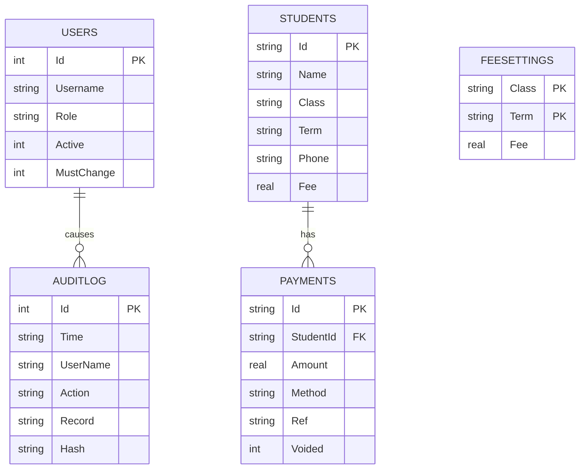

# Test checklist, demo script and data model

## Data model (paste into https://mermaid.live to draw it)

## Test checklist (tick each one and note the result)
| # | Area | Steps | Expected |
|---|------|-------|----------|
| 1 | Login | admin / admin123 | Forced to choose a new password |
| 2 | Login | Wrong password 5 times | Account locked; admin can reset |
| 3 | Password rule | New password "abcdefgh" | Rejected (needs a number) |
| 4 | Users | Admin adds general user "bursar" | Appears in list; logged ADD USER |
| 5 | Roles | Sign in as bursar | No Audit log, Users or Fee settings in menu; no Delete button |
| 6 | Register | Add a student | Fee suggested from Fee settings; logged REGISTER STUDENT |
| 7 | Duplicate | Register same name, class, term again | Blocked |
| 8 | Edit | Change a phone number | Logged EDIT STUDENT with before/after |
| 9 | Payment | Pay part of the fee | Balance and status update; receipt number RCPnnnn |
| 10 | Overpay | Pay more than the balance | Refused |
| 11 | Receipt | Print last receipt, then reprint | Second says REPRINT |
| 12 | Statement | Students > Statement | Lists payments; prints |
| 13 | Delete | Admin deletes a student with no payments | Reason required; logged with snapshot |
| 14 | Delete | Delete a student that has payments | Refused; says to void first |
| 15 | Void | Admin voids a payment | Reason required; balance goes back up; row struck through |
| 16 | Refund | Admin refunds part of a payment | New negative entry; cannot exceed original |
| 17 | Fees | Change a fee | Logged FEE CHANGE; existing students keep old fee |
| 18 | Import | Import a CSV with one bad row | Good rows imported; bad row listed with reason |
| 19 | Rollover | Term 1 to Term 2 with promotion | New records; JHS 3 skipped; no duplicates |
| 20 | Reports | Arrears list, filter by term, print | Correct students; prints |
| 21 | Audit | Open Audit log; filter by Delete | Delete rows highlighted red |
| 22 | Tamper | Edit a line in audit.log, then Verify log | Verify reports the mismatch |
| 23 | Backup | Back up, add a student, Restore, restart | Student added after backup is gone |
| 24 | Timeout | Leave idle 15 minutes | Signed out; SESSION TIMEOUT logged |
| 25 | One copy | Start the app twice | Second copy refuses to start |
| 26 | Multi-term | Student owes Term 1 (400). Pay 1000 | Dialog shows Term 1 400, Term 2 400, Term 3 200; confirm creates Terms 2 and 3 |
| 27 | Multi-term | After 26, open Students and the statement | Three term records; statement lists one receipt with lines per term |
| 28 | Multi-term | Print the receipt from 26 | One receipt, a line per term, total paid |
| 29 | Multi-term | Pay more than all remaining fees | Refused with a clear message |
| 30 | Multi-term | Void the receipt from 26 | All three lines voided together; balances restored |
| 31 | Multi-term | "Several terms..." with no amount, type amounts per term | Total updates; cannot exceed a term's balance |
| 32 | Upgrade | Open a database from the previous version | Opens fine; old payments still print |

## Demo script (about 5 minutes)
1. Show the login. Sign in as admin and point out the statistics on the dashboard.
2. Sign out, sign in as the general user. Show the limited menu and the user dashboard.
3. Register a student, record a part payment with "Pay full balance" unused, print the receipt.
4. Try to delete a student with payments (refused). Sign in as admin and void a payment with a reason.
5. Open the Audit log: show the entries for what you just did, including the red delete/void rows.
6. Click Verify log (intact). Edit one line in audit.log, click Verify log again (problem found).
7. Show Reports (arrears list) and Fee settings > Back up database.

## UI refresh checks (after the redesign; tick each one)
| # | Area | Steps | Expected |
|---|------|-------|----------|
| U1 | Sidebar | Click every menu item | Active item has indigo background, marker slides, page changes |
| U2 | Sidebar | Look at the bottom block | Initials, name, role; Sign out and Change password work |
| U3 | Dashboard | Open as admin and as general user | Cards show real figures; progress bar matches Paid / Fee |
| U4 | Record payment | Click + Record Payment with no student selected | Message asks to select a student |
| U5 | Record payment | Select a student, click + Record Payment, pay part | Window closes, receipt prompt appears, balances and cards update |
| U6 | Record payment | Pay full balance, Several terms..., overpay | Same behaviour as test cases 9, 10 and 26 to 31 |
| U7 | Students | Search, filter by class, term and status | Same results as before; status chips green, amber, red |
| U8 | Payments / Reports | Filters, void, refund, reprint, export | Unchanged; Status shows chips; report summary tiles match the table |
| U9 | Resize | Drag the window from 1000x640 up to maximised | No clipped or overlapping controls, tables scroll inside their card |
| U10 | Dialogs | Open every dialog | Consistent buttons, focus ring on text boxes |

## Polish round checks
| # | Area | Steps | Expected |
|---|------|-------|----------|
| P1 | Students | Open Students at 1000x640 and maximised | Search and filters on one row, actions on the next (Import/Export at the right); nothing wraps; Phone, then Fee and Paid, hide as the window narrows; no sideways scrolling |
| P2 | Students | Look beneath the table | Students, Expected, Collected, Outstanding shown as small tiles; they follow the filters |
| P3 | Activity | Admin dashboard, Recent activity | Each entry: dot, action, then user and full date/time (Today, Yesterday or 5 Nov 2026); hover shows the exact stamp |
| P4 | Analytics | Record a refund, open the admin dashboard | Payment methods contain no Refund bar or negative percentage; footer shows "Refunds issued"; percentages add up to about 100 |
| P5 | Cards | Check all stat cards | Same figure size, icon aligned on the right, progress bar and its label never overlap |
| P6 | Header | Admin dashboard | Title and Term selector on one line; changing the term updates cards, bars and table |
